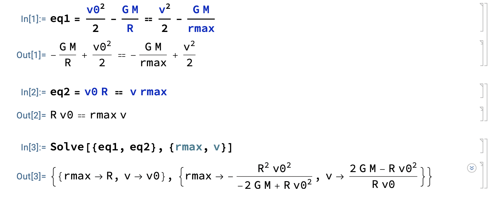

# Analysis
The ejected material is imparted with the angular velocity of the main body and
is released at the surface. With these two piece of information we can
determine its apoapsis. Given ejection velocity $v_{0}$ we see that  
\begin{align*}
-\frac{GMm}{R}\ +\ \frac{m v_{0}}{2}\ &=\ -\frac{GMm}{r_{max}}\ +\ \frac{mv}{2}\\
&\text{and}\\
R v_{0}\ &=\ r_{max} v
\end{align*}  
by conservation of energy and momentum respectively. Where $G$ is the
universal gravitational constant, $R$ is the radius of the asteroid, $M$ is its
mass, $v$ the velocity at apoapsis, and $r_{max}$ the distance from the center
to the apoapsis.  
Solving this system of equations we see that
\begin{align*}
r_{max} &= \frac{R^{2} v_{0}^{2}}{-2GM + R v_{0}^{2}}\\
v &= \frac{2GM - R v_{0}^{2}}{R v_{0}}
\end{align*}  

