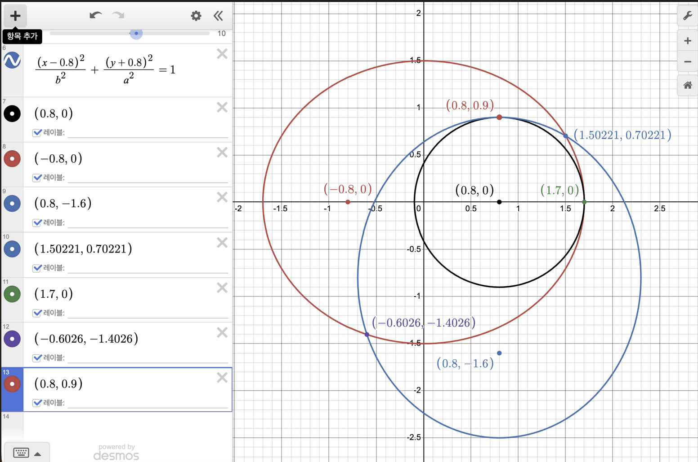
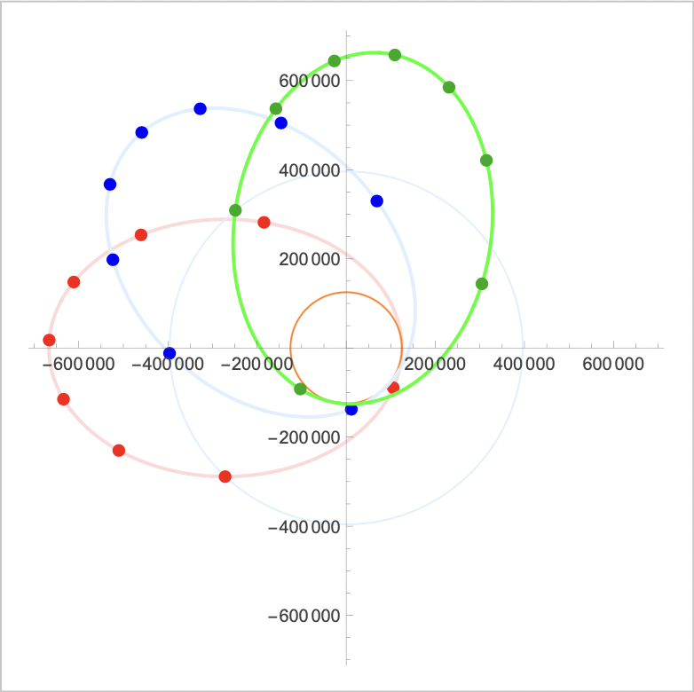

# Preliminaries
Here are the assumptions and hypothesis.  
For the sake of simplicity chariklo is assumed to be a perfect sphere.  
It is in space, so there is no air resistance by default.  
The hypothesis is that the rings of Chariklo are made from debris, ejected from its rotation, colliding with each other.
Because of the above assumptions it is easy to see that energy and momentum is conserved during collision unless it is inelastic.

The orbit of an ejected particle follows an ellipse, once it collides with
another such particle it would fall into a circular one.

This ellipse-circle transfer is the crux of the hypothesis. And as material
gets released and impact each other continuously, this transfer would "fill-in,"
so to speak, the rings.
