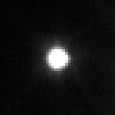
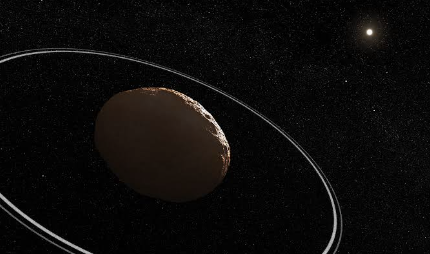

# Chariklo

Chariklo, discoverd in 2013, is an asteroid that has a ring, actually two rings.
The existence of its rings is very curious as on an intuitive level it'd
usually be from planets of great mass that one would expect to find a ring
system. So, a rudimentary investigation into how an asteroid might have gotten
a ring will be the subject of the next few posts.

