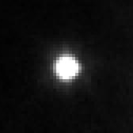
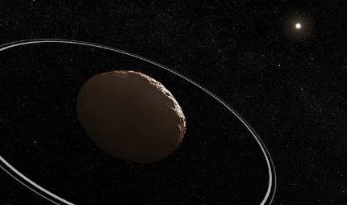

# Chariklo

Chariklo, discoverd in 2013, is an asteroid that has a ring, actually two rings.
The existence of its rings is very curious as on an intuitive level it'd
usually be from planets of great mass that one would expect to find a ring
system. So, a rudimentary investigation into how an asteroid might have gotten
a ring will be the subject of the next few posts.

There are many possible ways these rings could have formed.
The working hypothesis here is that it is the result of Chariklo's rotation ejecting
dedris which collided to form the rings.  
The next few pages will be dedicated to some inquiry into this hypothesis.
